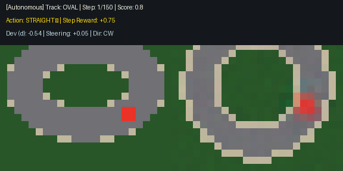
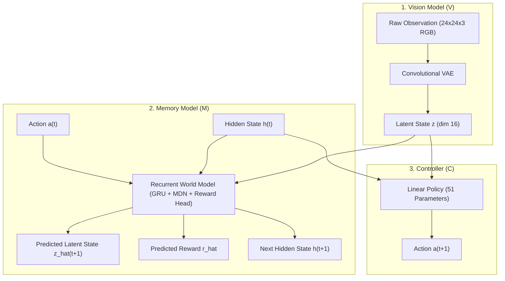
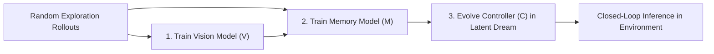
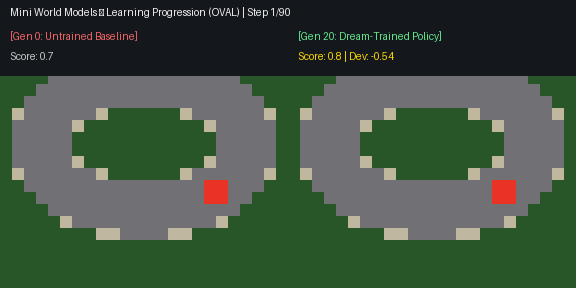
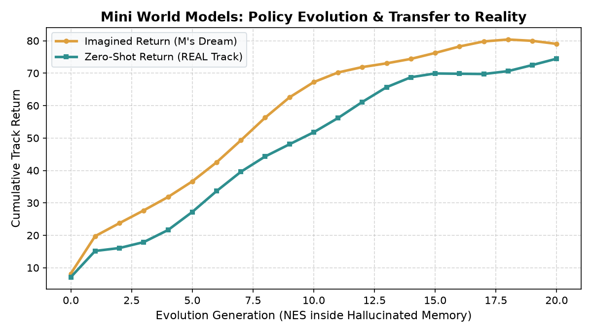
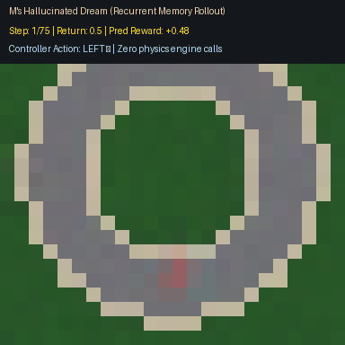

# World Models: Vision, Memory, and Controller on Car Racing

<div align="center">

[](https://www.python.org/downloads/release/python-3110/)
[](https://github.com/astral-sh/uv)
[-orange.svg)](https://arxiv.org/abs/1803.10122)

An implementation of Ha & Schmidhuber's classic **World Models** (2018) architecture on a top-down 2D car racing simulation, featuring real-time telemetry visualizers, hallucinated latent dreams, and policy evolution.

<br/>



<p>
  <strong>Autonomous Closed-Loop Racing:</strong> Real environment track (left) alongside ConvVAE latent reconstruction (right) with real-time steering and telemetry HUD.
</p>

</div>

---

## Architecture Overview

The system separates perceptual processing, temporal dynamics, and policy decisions into three decoupled components:

1. **Vision Model (V)**: A Convolutional Variational Autoencoder (ConvVAE) that compresses raw `24x24x3` RGB frames into a 16-dimensional latent representation ($z$).
2. **Memory Model (M)**: A recurrent predictive model combining a Gated Recurrent Unit (GRU) with a Mixture Density Network (MDN) and a scalar reward head. It forecasts the probability distribution over future latent vectors ($\hat{z}$) and expected rewards ($\hat{r}$) conditioned on prior actions.
3. **Controller (C)**: A compact linear policy (51 parameters) mapping $[z, h]$ directly to steering commands. The policy is trained entirely within hallucinated trajectories generated by $M$ using Natural Evolution Strategies (NES), eliminating real-world environment interactions during policy optimization.



### Training Pipeline

The training procedure executes sequentially through three stages:



---

## Visual Demonstrations & Showcase

### 1. Autonomous Closed-Loop Racing (Inference Mode)
The dream-evolved Controller ($C$, 51 parameters) maps the ConvVAE latent code $z \in \mathbb{R}^{16}$ and recurrent memory state $h$ directly to steering commands. The display renders the raw environment side-by-side with the real-time VAE reconstruction and live telemetry:

<div align="center">
  
  <p><em>Real Track Observation (left) vs. ConvVAE Reconstruction (right) at 25 FPS.</em></p>
</div>

### 2. Learning Progression: Untrained Baseline vs. Dream-Trained Policy
Policy evolution takes place entirely within $M$'s recurrent imagination. The split-screen below directly contrasts the untrained baseline (**Generation 0**, immediately running off track) against the evolved policy (**Generation 20**, navigating curves with high precision):

<div align="center">
  
  <p><em>Split-screen comparison: Generation 0 baseline (left) vs. Generation 20 dream-trained agent (right).</em></p>
</div>

The evaluation curve verifies that policies evolved purely inside the hallucinated memory transfer zero-shot to physical tracks:

<div align="center">
  
  <p><em>Zero-shot policy transfer: Imagined return in hallucinated dream vs. verified return in real simulation across 20 generations.</em></p>
</div>

### 3. Pure Imagination: Driving Inside $M$'s Hallucinated Dream
In **Dream Mode**, the physics simulation is halted completely after 4 warm-up steps. The car navigates purely within the recurrent memory dynamics ($M$: GRU + MDN + Reward Head), forecasting $\hat{z}_{t+1}$ and $\hat{r}_{t+1}$ which are decoded into visual frames by $V$:

<div align="center">
  
  <p><em>Closed-loop driving inside recurrent memory dynamics without physics engine queries.</em></p>
</div>

---

## Repository Structure

```
WOM/
├── assets/                   # README GIFs and visualization plots
│   ├── car_race_inference.gif
│   ├── learning_progression.gif
│   ├── dream_race.gif
│   └── learning_transfer_verdict.png
├── car_racer/
│   ├── __init__.py           # Package exports
│   ├── config.py             # Hyperparameters, constants, and paths
│   ├── env.py                # MiniRacer environment (kinematics, telemetry, reward)
│   ├── dataset.py            # Rollout collection and caching
│   ├── models/
│   │   ├── __init__.py
│   │   ├── vae.py            # Vision: ConvVAE implementation
│   │   ├── mdn_rnn.py        # Memory: GRU + MDN + Reward Head
│   │   └── controller.py     # Controller: Linear policy and NES optimizer
│   ├── train.py              # Modular training pipeline with live render callbacks
│   ├── visualize.py          # Pygame viewer, latent dream visualizer, GIF export
│   ├── demo_racing.py        # Interactive CLI runner for inference and diagnostics
│   ├── requirements.txt      # Legacy pip dependency specifications
│   ├── checkpoints/          # Serialized weights (vae.pt, mdn.pt, controller.npy)
│   ├── data/                 # Cached rollout datasets
│   └── outputs/              # Evaluation plots and exported animations
├── run_demo.py               # Top-level entry point for racing visualizers
├── run_train.py              # Top-level entry point for training pipeline
├── pyproject.toml            # Project configuration and dependency specifications
├── uv.lock                   # Deterministic lockfile
└── requirements.txt          # Fallback dependency file
```

---

## Environment Setup

The repository is managed with [uv](https://docs.astral.sh/uv/) for deterministic dependency management.

### Installation via uv

```bash
# Synchronize environment and install locked dependencies
uv sync

# Run scripts directly within the managed environment
uv run python run_demo.py --mode inference
```

### Alternative Installation via pip

```bash
# Create and activate a virtual environment
python -m venv .venv

# Windows
.venv\Scripts\activate

# Linux / macOS
source .venv/bin/activate

# Install dependencies
pip install -r requirements.txt
```

---

## Visualizer and Inference Modes

`run_demo.py` provides multiple operational modes to inspect both trained models and intermediate representations:

### 1. Real-Time Inference Mode

Runs the dream-trained controller in the closed-loop environment with an upscaled live track view, real-time VAE reconstruction, and a telemetry HUD:

```bash
uv run python run_demo.py --mode inference
```

**HUD Telemetry Fields:**
- **Control Mode**: Autonomous Controller (C)
- **Steering Command**: `LEFT`, `STRAIGHT`, or `RIGHT`
- **Centerline Deviation ($d$)**: Normalized displacement from track center
- **Heading Angle ($\phi$)**: Vehicle heading relative to the local track tangent
- **Direction**: Track orientation (`Clockwise` or `Counter-Clockwise`)
- **Performance**: Cumulative score and instantaneous step reward

### 2. Learning Progression Inspection

Displays driving behaviors across three checkpointed evolution stages (Generation 0 baseline, intermediate exploration, and converged generation):

```bash
uv run python run_demo.py --mode learning
```

### 3. Pure Imagination Dream Mode

Simulates and visualizes driving solely within the recurrent memory dynamics ($M$) without querying the physics engine:

```bash
uv run python run_demo.py --mode dream
```

### 4. Interactive Manual Driving

Allows direct user control using keyboard arrow keys (`Left`, `Up/Straight`, `Right`) for baseline calibration:

```bash
uv run python run_demo.py --mode manual
```

### 5. Animated GIF Export

Renders an evaluation episode to disk with full telemetry overlay:

```bash
uv run python run_demo.py --mode gif --track oval --gif-out outputs/car_race_demo.gif
```

### 6. Batch Showcase Media Export

Batch-generates all README demonstration media assets (`car_race_inference.gif`, `learning_progression.gif`, `dream_race.gif`, and `learning_transfer_verdict.png`) directly into `assets/`:

```bash
uv run python run_demo.py --export-demos --track oval
```

### 7. Zero-Shot Cross-Track Benchmark Suite

Evaluates the trained controller across all registered track topologies (`circle`, `oval`, `figure8`, `s_curve`) and outputs comparative returns, survival rates, and centerline errors:

```bash
uv run python run_demo.py --mode benchmark
```

> [!TIP]
> During interactive demo runs (`--mode inference` and `--mode manual`), press **`T`** at any time to cycle between track layouts live without restarting.

---

## Customizable Track Geometries

The environment includes a modular `Track` interface with built-in presets:

| Track Preset | Geometry Description | Key Challenges |
| :--- | :--- | :--- |
| `circle` | Standard concentric ring road ($R = 8.0$) | Baseline constant curvature |
| `oval` | Elongated stadium layout | High-speed straights into tight turns |
| `figure8` | Infinity-shaped ($\infty$) crossover | Alternating left and right transitions |
| `s_curve` | Serpentine 3-lobe wavy track | Rapid continuous steering reversals |

Tracks can be selected for training or inference via `--track <name>` (or `--track all` for composite dataset collection).

---

## Training Workflow

Models can be trained end-to-end or component-by-component.

### End-to-End Pipeline

```bash
uv run python run_train.py --train-all --track circle
```

### Component-Specific Training

```bash
# 1. Train Vision Model (V - ConvVAE) on specific track or all tracks
uv run python run_train.py --train-v --track all --epochs-v 30

# 2. Train Memory Model (M - MDN-RNN)
uv run python run_train.py --train-m --track circle --epochs-m 30

# 3. Evolve Controller (C) inside M's dream environment
uv run python run_train.py --train-c --track circle --gens-c 20

# 4. Evolve Controller with live evaluation render on the active track
uv run python run_train.py --train-c --track oval --render-learning --render-interval 5
```

### Command-Line Arguments Reference

| Option | Type | Default | Description |
| :--- | :--- | :--- | :--- |
| `--train-all` | Flag | `False` | Run full V, M, and C training sequence |
| `--train-v` | Flag | `False` | Train Vision model only |
| `--train-m` | Flag | `False` | Train Memory model only |
| `--train-c` | Flag | `False` | Evolve Controller policy only |
| `--track` | String | `circle` | Target track: `circle`, `oval`, `figure8`, `s_curve`, or `all` |
| `--epochs-v` | Integer | `30` | Number of epochs for VAE training |
| `--epochs-m` | Integer | `30` | Number of epochs for MDN-RNN training |
| `--gens-c` | Integer | `20` | Number of generations for controller evolution |
| `--render-learning` | Flag | `False` | Display live visual render during evolution |
| `--render-interval` | Integer | `5` | Rendering frequency in generations |
| `--force-recollect` | Flag | `False` | Re-sample rollouts ignoring cached dataset |

---

## References

- Ha, D., & Schmidhuber, J. (2018). *Recurrent World Models Facilitate Policy Evolution*. Advances in Neural Information Processing Systems (NeurIPS 2018). [arXiv:1803.10122](https://arxiv.org/abs/1803.10122).
