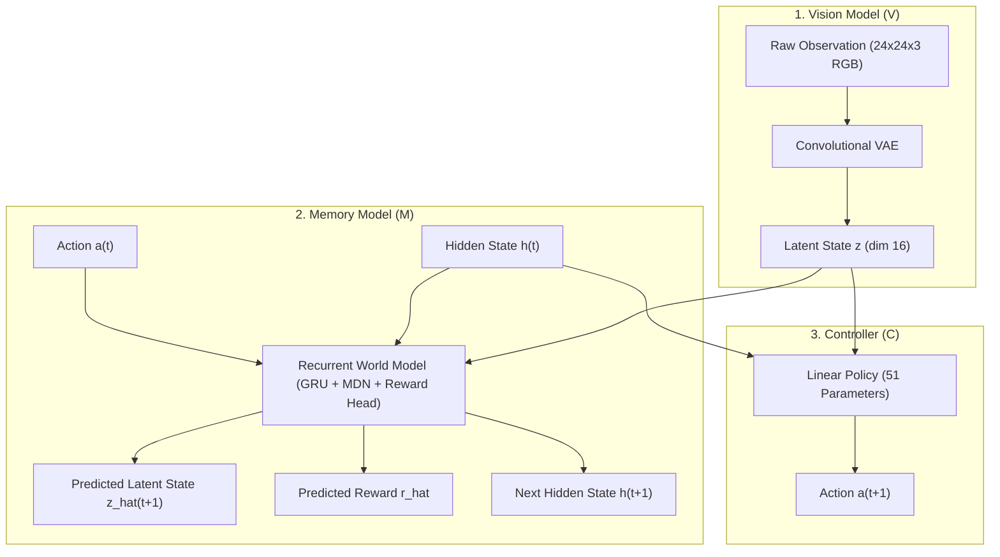
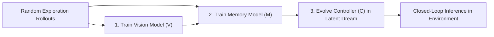

# World Models: Vision, Memory, and Controller on Car Racing

An implementation of the World Models architecture (Ha & Schmidhuber, 2018) applied to a top-down car racing track, featuring live real-time visualizers for training and inference.

---

## Architecture Overview

The system separates perceptual processing, temporal dynamics, and policy decisions into three decoupled components:

1. **Vision Model (V)**: A Convolutional Variational Autoencoder (ConvVAE) that compresses raw `24x24x3` RGB frames into a 16-dimensional latent representation ($z$).
2. **Memory Model (M)**: A recurrent predictive model combining a Gated Recurrent Unit (GRU) with a Mixture Density Network (MDN) and a scalar reward head. It forecasts the probability distribution over future latent vectors ($\hat{z}$) and expected rewards ($\hat{r}$) conditioned on prior actions.
3. **Controller (C)**: A compact linear policy (51 parameters) mapping $[z, h]$ directly to steering commands. The policy is trained entirely within hallucinated trajectories generated by $M$ using Natural Evolution Strategies (NES), eliminating real-world environment interactions during policy optimization.



### Training Pipeline

The training procedure executes sequentially through three stages:



---

## Repository Structure

```
WOM/
├── car_racer/
│   ├── __init__.py           # Package exports
│   ├── config.py             # Hyperparameters, constants, and paths
│   ├── env.py                # MiniRacer environment (kinematics, telemetry, reward)
│   ├── dataset.py            # Rollout collection and caching
│   ├── models/
│   │   ├── __init__.py
│   │   ├── vae.py            # Vision: ConvVAE implementation
│   │   ├── mdn_rnn.py        # Memory: GRU + MDN + Reward Head
│   │   └── controller.py     # Controller: Linear policy and NES optimizer
│   ├── train.py              # Modular training pipeline with live render callbacks
│   ├── visualize.py          # Pygame viewer, latent dream visualizer, GIF export
│   ├── demo_racing.py        # Interactive CLI runner for inference and diagnostics
│   ├── requirements.txt      # Legacy pip dependency specifications
│   ├── checkpoints/          # Serialized weights (vae.pt, mdn.pt, controller.npy)
│   ├── data/                 # Cached rollout datasets
│   └── outputs/              # Evaluation plots and exported animations
├── run_demo.py               # Top-level entry point for racing visualizers
├── run_train.py              # Top-level entry point for training pipeline
├── pyproject.toml            # Project configuration and dependency specifications
├── uv.lock                   # Deterministic lockfile
└── requirements.txt          # Fallback dependency file
```

---

## Environment Setup

The repository is managed with [uv](https://docs.astral.sh/uv/) for deterministic dependency management.

### Installation via uv

```bash
# Synchronize environment and install locked dependencies
uv sync

# Run scripts directly within the managed environment
uv run python run_demo.py --mode inference
```

### Alternative Installation via pip

```bash
# Create and activate a virtual environment
python -m venv .venv

# Windows
.venv\Scripts\activate

# Linux / macOS
source .venv/bin/activate

# Install dependencies
pip install -r requirements.txt
```

---

## Visualizer and Inference Modes

`run_demo.py` provides multiple operational modes to inspect both trained models and intermediate representations:

### 1. Real-Time Inference Mode

Runs the dream-trained controller in the closed-loop environment with an upscaled live track view, real-time VAE reconstruction, and a telemetry HUD:

```bash
uv run python run_demo.py --mode inference
```

**HUD Telemetry Fields:**
- **Control Mode**: Autonomous Controller (C)
- **Steering Command**: `LEFT`, `STRAIGHT`, or `RIGHT`
- **Centerline Deviation ($d$)**: Normalized displacement from track center
- **Heading Angle ($\phi$)**: Vehicle heading relative to the local track tangent
- **Direction**: Track orientation (`Clockwise` or `Counter-Clockwise`)
- **Performance**: Cumulative score and instantaneous step reward

### 2. Learning Progression Inspection

Displays driving behaviors across three checkpointed evolution stages (Generation 0 baseline, intermediate exploration, and converged generation):

```bash
uv run python run_demo.py --mode learning
```

### 3. Pure Imagination Dream Mode

Simulates and visualizes driving solely within the recurrent memory dynamics ($M$) without querying the physics engine:

```bash
uv run python run_demo.py --mode dream
```

### 4. Interactive Manual Driving

Allows direct user control using keyboard arrow keys (`Left`, `Up/Straight`, `Right`) for baseline calibration:

```bash
uv run python run_demo.py --mode manual
```

### 5. Animated GIF Export

Renders an evaluation episode to disk with full telemetry overlay:

```bash
uv run python run_demo.py --mode gif --gif-out outputs/car_race_demo.gif
```

---

## Training Workflow

Models can be trained end-to-end or component-by-component.

### End-to-End Pipeline

```bash
uv run python run_train.py --train-all
```

### Component-Specific Training

```bash
# 1. Train Vision Model (V - ConvVAE)
uv run python run_train.py --train-v --epochs-v 30

# 2. Train Memory Model (M - MDN-RNN)
uv run python run_train.py --train-m --epochs-m 30

# 3. Evolve Controller (C) inside M's dream environment
uv run python run_train.py --train-c --gens-c 20

# 4. Evolve Controller with live evaluation render every N generations
uv run python run_train.py --train-c --render-learning --render-interval 5
```

### Command-Line Arguments Reference

| Option | Type | Default | Description |
| :--- | :--- | :--- | :--- |
| `--train-all` | Flag | `False` | Run full V, M, and C training sequence |
| `--train-v` | Flag | `False` | Train Vision model only |
| `--train-m` | Flag | `False` | Train Memory model only |
| `--train-c` | Flag | `False` | Evolve Controller policy only |
| `--epochs-v` | Integer | `30` | Number of epochs for VAE training |
| `--epochs-m` | Integer | `30` | Number of epochs for MDN-RNN training |
| `--gens-c` | Integer | `20` | Number of generations for controller evolution |
| `--render-learning` | Flag | `False` | Display live visual render during evolution |
| `--render-interval` | Integer | `5` | Rendering frequency in generations |
| `--force-recollect` | Flag | `False` | Re-sample rollouts ignoring cached dataset |

---

## References

- Ha, D., & Schmidhuber, J. (2018). *Recurrent World Models Facilitate Policy Evolution*. Advances in Neural Information Processing Systems (NeurIPS 2018). [arXiv:1803.10122](https://arxiv.org/abs/1803.10122).
