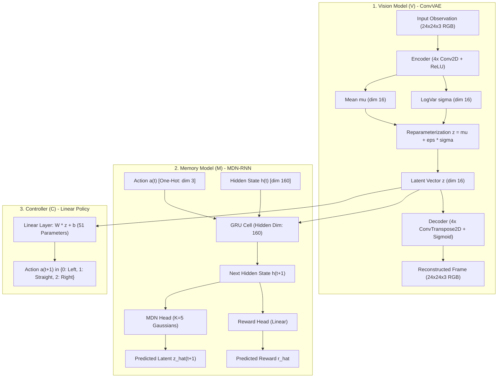

# World Models: Vision, Memory, and Controller Package

A modular implementation of the World Models architecture (Ha & Schmidhuber, 2018) applied to a 2D top-down car racing simulation. The system decouples visual perception, temporal dynamics forecasting, and policy evolution.

---

## Architecture and Data Flow



### Module Responsibilities

1. **Vision Model (V)**: A 4-layer Convolutional Variational Autoencoder (`car_racer/models/vae.py`) compressing high-dimensional image inputs ($24 \times 24 \times 3 = 1,728$ values) into a 16-dimensional latent vector $z$.
2. **Memory Model (M)**: A Recurrent Neural Network (`car_racer/models/mdn_rnn.py`) combining a 160-dimensional GRU with a Mixture Density Network (5 Gaussian components) and a scalar reward head. It forecasts future latent transitions $P(z_{t+1} \mid z_t, a_t, h_t)$ and expected step returns $\hat{r}_{t+1}$.
3. **Controller (C)**: A linear policy (`car_racer/models/controller.py`) containing 51 parameters ($16 \times 3 + 3$). The policy is trained strictly inside synthetic trajectories hallucinated by $M$ using Natural Evolution Strategies (NES), requiring zero interaction with the real physics engine during policy optimization.

---

## Package Organization

```
car_racer/
├── __init__.py           # Package exports and public interface
├── config.py             # Hyperparameters, device configuration, and file paths
├── env.py                # MiniRacer simulation environment and Frenet kinematics
├── dataset.py            # Rollout experience collection and cache management
├── benchmark.py          # Cross-track zero-shot generalization benchmark suite
├── visualize.py          # Pygame viewer, HUD overlay, and GIF export
├── demo_racing.py        # CLI entry point for visual modes and benchmarks
├── train.py              # Modular training pipeline with live render callbacks
├── tracks/               # Modular road geometry package
│   ├── __init__.py       # Track module exports
│   ├── base.py           # Abstract Track base class
│   ├── circle.py         # Circular ring road preset
│   ├── parametric.py     # ParametricClosedTrack curve discretizer
│   ├── presets.py        # Oval, Figure8, and SCurve geometry implementations
│   └── registry.py       # Global track registry and lookup utilities
├── models/               # PyTorch neural network architectures
│   ├── __init__.py       # Model module exports
│   ├── vae.py            # ConvVAE implementation
│   ├── mdn_rnn.py        # MDN-RNN implementation and sampling functions
│   └── controller.py     # Controller policy and NES optimizer
├── checkpoints/          # Serialized weights (vae.pt, mdn.pt, controller.npy)
├── data/                 # Cached rollout datasets (random_dataset_<track>.npz)
└── outputs/              # Exported plots and GIF animations
```

---

## Key Engineering Implementations

### 1. Weighted Non-Background Reconstruction Loss
The vehicle occupies only 4 out of 576 pixels ($0.7\%$ of the visual frame). Standard Mean Squared Error (MSE) loss causes the autoencoder to ignore the vehicle and reconstruct an empty road. The VAE implementation applies a $30\times$ penalty weight to non-background pixels, forcing the latent representation to preserve exact vehicle position and steering angle.

### 2. Latent Manifold Smoothing via Noise Injection
During decoder training, Gaussian noise ($\sigma = 0.10$) is added to latent code $z$ before decoding:

$$z_{\text{noisy}} = z + \epsilon, \quad \epsilon \sim \mathcal{N}(0, 0.10^2 \cdot \mathbf{I})$$

This prevents the decoder from overfitting to discrete points, ensuring that near-miss latent predictions generated by $M$ during dream rollouts decode into coherent visual representations rather than degenerate artifacts.

### 3. Multimodal Dynamics with Mixture Density Outputs
Because episode direction (clockwise vs. counter-clockwise) is sampled as a hidden coin flip at reset, the environment transition dynamics are multimodal. A standard regression head averages divergent paths into an uninformative blur. The MDN head models future states using a mixture of $K=5$ Gaussian distributions:

$$P(z_{t+1} \mid z_t, a_t, h_t) = \sum_{k=1}^{K} \pi_k \cdot \mathcal{N}\left(\mu_k, \sigma_k^2 \cdot \mathbf{I}\right)$$

### 4. Zero-Environment Policy Training
The Controller policy is evolved inside $M$'s recurrent imagination. A candidate parameter vector is evaluated over 40-step dreamed rollouts starting from warm-up latent codes. The learned reward head $\hat{r}$ provides feedback to Natural Evolution Strategies (NES) using Antithetic Perturbation Pairs, achieving robust zero-shot transfer when tested on the real physics environment.

### 5. Modular Frenet-Serret Track Kinematics
Vehicle motion is computed in curvilinear Frenet coordinates $(s, d, \phi)$ along parametric curves, updating progress via:

$$\Delta s = \text{direction} \cdot \frac{\text{SPEED}}{\max(0.2, 1.0 + d \cdot \kappa(s))}$$

This decoupling allows policies to be evaluated across varied track geometries (`circle`, `oval`, `figure8`, `s_curve`) without retraining.

---

## Environment Setup

Dependencies and virtual environments are managed using [uv](https://docs.astral.sh/uv/):

```bash
# Synchronize environment
uv sync

# Run interactive visualizer
uv run python -m car_racer.demo_racing --mode inference --track oval
```

---

## Operational Workflows

### 1. Interactive Racing Visualizer

```bash
# Real-time autonomous driving with side-by-side VAE reconstruction
uv run python -m car_racer.demo_racing --mode inference --track figure8

# Manual keyboard driving (Left / Up / Right arrows)
uv run python -m car_racer.demo_racing --mode manual --track s_curve

# Pure imagination mode (visualizing M's recurrent dream without game physics)
uv run python -m car_racer.demo_racing --mode dream

# Three-stage learning progression comparison (Gen 0 vs Mid vs Gen 20)
uv run python -m car_racer.demo_racing --mode learning --track circle
```

> [!TIP]
> During interactive demo modes (`inference` and `manual`), press **`T`** to cycle dynamically between available track geometries.

### 2. Zero-Shot Generalization Benchmark

Evaluates policy transfer across all registered track topologies:

```bash
uv run python -m car_racer.demo_racing --mode benchmark
```

Generates comparative metrics and exports a performance summary plot to `car_racer/outputs/zero_shot_generalization.png`.

### 3. Component-Specific Training Pipeline

Train individual models or the complete pipeline end-to-end:

```bash
# End-to-end training (V -> M -> C)
uv run python -m car_racer.train --train-all --track circle

# Train Vision model (V) on composite multi-track dataset
uv run python -m car_racer.train --train-v --track all --epochs-v 30

# Train Memory model (M) on specific track rollouts
uv run python -m car_racer.train --train-m --track circle --epochs-m 30

# Evolve Controller (C) with live visual evaluation every 5 generations
uv run python -m car_racer.train --train-c --track oval --render-learning --render-interval 5
```

---

## References

- Ha, D., & Schmidhuber, J. (2018). *Recurrent World Models Facilitate Policy Evolution*. Advances in Neural Information Processing Systems (NeurIPS 2018). [arXiv:1803.10122](https://arxiv.org/abs/1803.10122).
- Bishop, C. M. (1994). *Mixture Density Networks*. Technical Report NCRG/94/004, Aston University.
- Salimans, T., Ho, J., Chen, X., Sidor, S., & Sutskever, I. (2017). *Evolution Strategies as a Scalable Alternative to Reinforcement Learning*. [arXiv:1703.03864](https://arxiv.org/abs/1703.03864).
