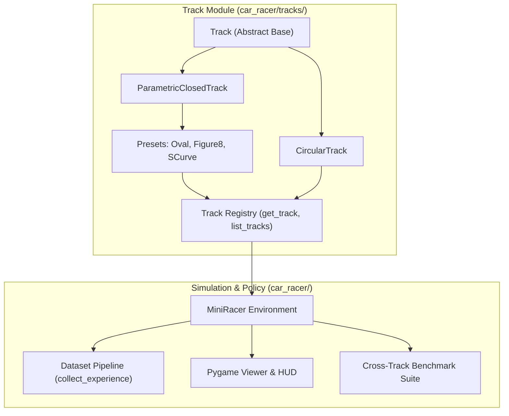
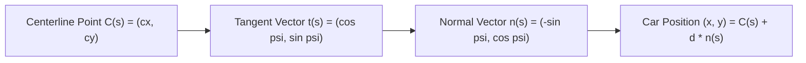

# Modular Track Architecture and Custom Road Geometries

This document details the design, mathematics, operational workflows, and extension mechanisms for the modular racetrack system in Mini World Models.

---

## 1. System Overview

Prior implementations coupled track rasterization, physics, and reward signals to a fixed circular ring road. The modular track system separates geometric representations from vehicle kinematics and perceptual simulation.



### Key Architectural Properties

- **Zero-Shot Transfer Testing**: Controllers trained on one topology (e.g., `circle`) can be deployed directly onto unseen tracks (e.g., `oval`, `figure8`, or `s_curve`) without modifying model weights.
- **Consistent Observation Space**: All tracks output normalized $24 \times 24 \times 3$ float32 RGB arrays with uniform color palettes (grass green, asphalt gray, sand kerbs, and red vehicle chassis).
- **Invariant Reward Scaling**: The reward formulation remains $1.0 - \frac{|d|}{\text{HALF\_W}}$, ensuring returns are directly comparable across shapes.

---

## 2. Mathematical Foundations

The car moves within a local curvilinear Frenet-Serret coordinate frame along the road centerline:



### State Representation

At any timestep $t$, the kinematic state is parameterized by:

$$\mathbf{s}_t = (s, d, \phi, \text{direction})$$

- $s \in [0, L)$: Longitudinal arc-length distance along the closed curve of total length $L$.
- $d \in [-\text{HALF\_W}, \text{HALF\_W}]$: Lateral deviation from the centerline ($\text{HALF\_W} = 2.0\text{--}2.2$).
- $\phi \in [-0.7, 0.7]$: Vehicle heading angle error relative to the local curve tangent $\psi(s)$.
- $\text{direction} \in \{-1, +1\}$: Episode traversal orientation (forward or reverse).

### Curvilinear Stepping Equations

Given steering command $a \in \{0, 1, 2\}$ ($0 = \text{left}, 1 = \text{straight}, 2 = \text{right}$):

1. **Heading Angle Update**:
   $$\phi_{t+1} = \text{clip}\left(\phi_t + 0.16 \cdot (a - 1), -0.7, 0.7\right)$$

2. **Lateral Deviation Update**:
   $$d_{t+1} = d_t + 1.1 \cdot \sin(\phi_{t+1})$$

3. **Kerb Damping & Collision Constraints**:
   If $|d_{t+1}| > \text{HALF\_W}$, the vehicle scrapes the kerb:
   $$d_{t+1} = \text{clip}(d_{t+1}, -\text{HALF\_W}, \text{HALF\_W})$$
   $$\phi_{t+1} \leftarrow 0.4 \cdot \phi_{t+1}$$

4. **Arc-Length Progress**:
   Accounting for the signed local curvature $\kappa(s) = \frac{d\psi}{ds}$:
   $$\Delta s = \text{direction} \cdot \frac{\text{SPEED}}{\max(0.2, 1.0 + d \cdot \kappa(s))}$$
   $$s_{t+1} = (s_t + \Delta s) \pmod{L}$$

5. **Step Reward**:
   $$r_{t+1} = 1.0 - \frac{|d_{t+1}|}{\text{HALF\_W}}$$

### 2D Background Rasterization

For any closed parametric curve $C(u)$ with $u \in [0, 1]$, the $24 \times 24$ canvas is generated by computing the Euclidean distance from each discrete pixel center $(p_x, p_y)$ to the dense centerline polygon:

$$\text{dist}(p_x, p_y) = \min_{i} \| (p_x, p_y) - C(s_i) \|_2$$

Each pixel is assigned based on thresholds:
- $\text{dist} \le \text{HALF\_W}$: Asphalt Road (`[0.44, 0.44, 0.46]`)
- $\text{HALF\_W} < \text{dist} \le \text{HALF\_W} + 0.45$: Concrete Kerb (`[0.75, 0.72, 0.62]`)
- $\text{dist} > \text{HALF\_W} + 0.45$: Grass Background (`[0.16, 0.34, 0.16]`)

---

## 3. Built-in Track Presets

| Identifier | Class | Mathematical Formulation | Driving Dynamics |
| :--- | :--- | :--- | :--- |
| `circle` | `CircularTrack` | $x = c + R \cos(\theta)$<br>$y = c + R \sin(\theta)$ | Constant curvature ($\kappa = 0.125$). Baseline benchmark. |
| `oval` | `OvalTrack` | $x = c + 8.5 \cos(\theta)$<br>$y = c + 5.5 \sin(\theta)$ | Straight sections transitioning into high-g tight cornering. |
| `figure8` | `Figure8Track` | $x = c + 7.5 \cos(\theta)$<br>$y = c + 5.5 \sin(2\theta)$ | Crossover layout with alternating left and right direction transitions. |
| `s_curve` | `SCurveTrack` | $r = 7.5 + 2.0 \cos(3\theta)$<br>$x = c + r \cos(\theta), y = c + r \sin(\theta)$ | Serpentine 3-lobe layout requiring rapid continuous steering reversals. |

---

## 4. How to Create and Register Custom Tracks

Creating a new track requires only defining a parametric 2D closed curve function:

```python
import numpy as np
from car_racer.tracks.parametric import ParametricClosedTrack
from car_racer.tracks.registry import register_track

class CloverTrack(ParametricClosedTrack):
    def __init__(self, size: int = 24, half_w: float = 2.0):
        c = (size - 1) / 2.0

        def curve(u: float) -> tuple[float, float]:
            theta = 2.0 * np.pi * u
            # 4-leaf clover modulation
            r = 7.0 + 2.2 * np.cos(4.0 * theta)
            x = c + r * np.cos(theta)
            y = c + r * np.sin(theta)
            return float(x), float(y)

        super().__init__(name="clover", curve_fn=curve, num_samples=1000, size=size, half_w=half_w)

# Register the track into the global registry
register_track("clover", lambda **kw: CloverTrack(**kw))
```

Once registered, `"clover"` is immediately accessible everywhere via `--track clover`, `MiniRacer(track="clover")`, and dataset generation.

---

## 5. Dataset Workflows

Datasets of exploration rollouts are collected and versioned per track.

### Single-Track Dataset Collection

```bash
# Collect rollouts specifically on the oval track
uv run python run_train.py --train-v --track oval --epochs-v 30
```

This saves rollouts to `car_racer/data/random_dataset_oval.npz`.

### Composite Multi-Track Dataset Collection

Passing `--track all` distributes rollout episodes evenly across every registered track (`circle`, `oval`, `figure8`, `s_curve`):

```bash
# Collect composite dataset across all track layouts
uv run python run_train.py --train-v --track all --epochs-v 30
```

This saves to `car_racer/data/random_dataset_all.npz`, allowing the Vision model (ConvVAE) and Memory model (MDN-RNN) to learn a shared, topology-invariant latent space.

---

## 6. Live Visualization and Runtime Controls

### Real-Time Inference Mode

```bash
uv run python run_demo.py --mode inference --track figure8
```

- **Interactive Track Cycling**: Press **`T`** while the Pygame window is active to cycle dynamically to the next track layout without resetting the process.
- **Side-by-Side Reconstruction**: Displays the live track view adjacent to the ConvVAE latent reconstruction.

### Manual Human Driving

```bash
uv run python run_demo.py --mode manual --track s_curve
```

- **Controls**:
  - `Left Arrow`: Steer Left
  - `Up Arrow`: Drive Straight
  - `Right Arrow`: Steer Right
  - `T Key`: Cycle to next track layout

### Live Rendering During Training

```bash
uv run python run_train.py --train-c --track oval --render-learning --render-interval 5
```

Pops up a Pygame window every 5 generations to show the evolving controller driving on the target track geometry.

---

## 7. Cross-Track Benchmark Suite

The benchmark evaluates zero-shot transfer performance across all registered track geometries:

```bash
uv run python run_demo.py --mode benchmark
```

### Metrics Recorded

1. **Mean Return**: Cumulative score achieved over the evaluation horizon (100 steps).
2. **Survival Steps**: Number of steps before episode termination.
3. **Mean Centerline Deviation ($|d|$)**: Average distance from track center (lower indicates superior lane discipline).

### Sample Benchmark Output

```
================================================================================
 ZERO-SHOT GENERALIZATION BENCHMARK ACROSS ROAD TOPOLOGIES
================================================================================
 Episodes per track: 5 | Evaluation Horizon: 100 steps
--------------------------------------------------------------------------------
 Track Name       | Mean Return        | Survival Steps     | Centerline |d|  
--------------------------------------------------------------------------------
 CIRCLE           |   44.4 +/-  3.3    | 100.0 / 100        | 1.22 +/- 0.07   
 OVAL             |    8.3 +/-  0.8    | 100.0 / 100        | 2.02 +/- 0.02   
 FIGURE8          |   33.6 +/-  4.4    | 100.0 / 100        | 1.46 +/- 0.10   
 S_CURVE          |    9.8 +/-  6.6    | 100.0 / 100        | 1.98 +/- 0.14   
================================================================================
[Benchmark] Saved comparison plot to: car_racer/outputs/zero_shot_generalization.png
```

A comparison bar chart is automatically saved to `car_racer/outputs/zero_shot_generalization.png`.

---

## 8. CLI Reference Summary

| Script | Flag | Arguments | Description |
| :--- | :--- | :--- | :--- |
| `run_demo.py` | `--mode` | `inference`, `manual`, `benchmark`, `learning`, `dream`, `gif` | Execution mode |
| `run_demo.py` | `--track` | `circle`, `oval`, `figure8`, `s_curve` | Track geometry selection |
| `run_demo.py` | `--gif-out` | File path | Destination path for GIF animation export |
| `run_train.py` | `--track` | `circle`, `oval`, `figure8`, `s_curve`, `all` | Target track for dataset and evaluation |
| `run_train.py` | `--render-learning` | Flag | Enable visual evaluation rendering during evolution |
| `run_train.py` | `--render-interval` | Integer ($N$) | Evaluation rendering frequency in generations |
